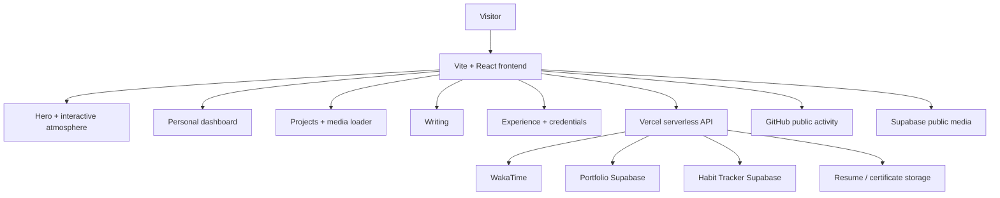

<div align="center">

# Nityant Tiwari — Portfolio

### Backend / Software Engineering · AI/ML Engineering · Interactive Web Systems

<p>
  A production-focused personal portfolio built as an interactive engineering surface — not a static résumé page.
</p>

<p>
  <a href="https://thenityant.runs-on.dev">
    
  </a>
</p>

<p>
  
  
  
  
  
</p>

</div>

---

## Live experience

<div align="center">

### [Launch the portfolio →](https://thenityant.runs-on.dev)

**Best viewed as the actual site.** The portfolio uses live motion, WebGL, project media, responsive interactions, and data-backed dashboard elements that a static README preview cannot reproduce faithfully.

</div>

---

## What this project is

This repository powers my personal engineering portfolio. It is designed around the idea that a portfolio should demonstrate how I build software, not just list what I have built.

The site combines a deliberately minimal interface with live interaction, project media, technical writing, engineering experience, external data sources, and device-aware performance behavior.

### Highlights

- **Interactive visual atmosphere** powered by ShaderGradient and WebGL.
- **Personal engineering dashboard** with GitHub activity, coding time, workouts, tools, location, and current-build context.
- **Project showcase** organized across backend, full-stack/app development, AI/ML, and robotics/embedded work.
- **Media-aware project cards** with lazy loading, preload orchestration, responsive playback behavior, and mobile-specific optimizations.
- **Writing system** for long-form engineering notes such as the LLM Engineering Notebook.
- **Experience + credential archive** backed by portfolio storage and serverless API routes.
- **Responsive mobile experience** with reduced compute pressure on touch devices while preserving the design language.
- **Serverless data layer** for WakaTime, workout metrics, certificates, resume delivery, and health checks.

---

## Architecture



The production site is frontend-first. Sensitive integrations stay behind serverless routes rather than being exposed in the browser.

---

## Tech stack

| Layer | Technology |
| --- | --- |
| Frontend | React 19, TypeScript, Vite |
| Styling | CSS, responsive layout systems, custom interaction layers |
| 3D / visual effects | Three.js, React Three Fiber, ShaderGradient, COBE |
| Routing | Wouter |
| Icons | Lucide React |
| Backend endpoints | Vercel serverless functions / TypeScript |
| Data & storage | Supabase |
| Live coding metric | WakaTime |
| Deployment | Vercel |
| Package manager | pnpm |

---

## Performance work

A large part of this project has been about keeping a visually rich portfolio usable on real hardware.

Current performance work includes:

- viewport-aware project video loading;
- metadata warming and user-intent media preloading;
- conditional mobile rendering for expensive visual effects;
- reduced globe rendering cost on touch devices;
- off-screen rendering containment;
- lazy certificate and writing-preview loading;
- compositor isolation for WebGL and video surfaces;
- connection-aware behavior for slower/data-saver clients;
- responsive interaction changes for Android and other touch devices.

The goal is not to remove the visual system for performance. It is to make the browser spend resources where the visitor is actually looking.

---

## Repository structure

```text
.
├── api/                    # Serverless API routes
│   ├── coding.ts
│   ├── workouts.ts
│   ├── resume.ts
│   ├── hackathon-certificates.ts
│   └── health.ts
│
├── client/
│   ├── public/
│   └── src/
│       ├── components/
│       │   ├── home/
│       │   ├── layout/
│       │   └── ui/
│       ├── data/
│       ├── hooks/
│       ├── lib/
│       ├── pages/
│       └── styles/
│
├── server/                 # Local API development bridge
├── licenses/               # Third-party / preserved license texts
├── NOTICE                  # Required attribution notices
├── THIRD_PARTY_NOTICES.md
├── vercel.json
├── vite.config.ts
└── package.json
```

---

## Running locally

### Prerequisites

- Node.js
- pnpm 10+

Clone the repository:

```bash
git clone https://github.com/TheNityant/MY_PORTFOLIO.git
cd MY_PORTFOLIO
pnpm install
```

Create a local environment file from the example:

```bash
cp .env.example .env
```

On PowerShell:

```powershell
Copy-Item .env.example .env
```

Then start the frontend:

```bash
pnpm dev
```

For local API development:

```bash
pnpm dev:api
```

Useful checks:

```bash
pnpm check
pnpm build:web
```

Do not commit real API keys or service-role credentials. The checked-in `.env.example` documents the expected configuration surface without exposing secrets.

---

## Serverless endpoints

The production deployment currently includes routes for:

| Endpoint | Purpose |
| --- | --- |
| `/api/coding` | Coding-time data |
| `/api/workouts` | Workout metrics |
| `/api/resume` | Resume resolution / delivery |
| `/api/hackathon-certificates` | Credential archive discovery |
| `/api/certificate-file` | Certificate file delivery |
| `/api/health` | Integration / deployment health |

---

## Design philosophy

This project intentionally avoids the usual “developer portfolio template” look.

The interface is built around a few principles:

**Show the work.** Projects should feel inspectable rather than reduced to title cards.

**Keep motion purposeful.** Animation should create atmosphere or communicate state, not exist merely because it can.

**Make responsiveness architectural.** Mobile is treated as a different compute and interaction environment, not just a narrower desktop viewport.

**Keep the portfolio extensible.** Writing, projects, credentials, live metrics, and future systems such as the LLM Engineering Notebook can grow without rebuilding the site around them.

---

## Deployment

The production application is deployed through Vercel.

**Live:** [https://thenityant.runs-on.dev](https://thenityant.runs-on.dev)

The Vite production build is generated with:

```bash
pnpm build:web
```

with output written to:

```text
dist/public
```

---

## Attribution

Parts of the portfolio's information architecture were adapted from Apache-2.0 licensed source by Shivam Patel.

The required attribution and third-party details are preserved in:

- [NOTICE](./NOTICE)
- [THIRD_PARTY_NOTICES.md](./THIRD_PARTY_NOTICES.md)
- [licenses/](./licenses)

No personal content, photographs, biographies, or proprietary media from the reference portfolio are reused.

---

## License

The repository source code is distributed under the **Apache License 2.0**.

See [LICENSE](./LICENSE) for the full terms.

Third-party components and adapted source remain subject to their respective notices and license requirements.

---

<div align="center">

Built and maintained by **Nityant Tiwari**

[Portfolio](https://thenityant.runs-on.dev) · [GitHub](https://github.com/TheNityant) · [LinkedIn](https://www.linkedin.com/in/nityant-tiwari-88b97533b/)

</div>
